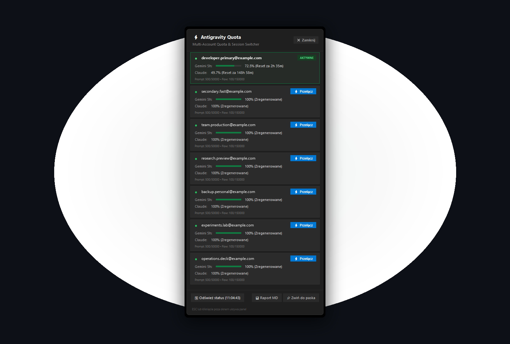

# Antigravity Quota Tray

> 🌐 **English** · [Polski](README.pl.md)

> Windows System Tray application & CLI for monitoring Google Antigravity AI quotas (Gemini and Claude) and switching active session accounts.

<p align="center">
  
</p>

---

## Features

* **Real-Time Quota Monitoring:** Queries the local Antigravity Language Server (supporting release 2.34+ and earlier) or falls back to local cache when offline.
* **Multi-Account Session Switching:** Switch the active account in Windows Credential Manager (`gemini:antigravity`) directly from the tray flyout or CLI without restarting the editor.
* **Windows 11 Shell Integration:** Modern dark-mode flyout with rounded corners, DWM drop shadows, auto-dismiss on focus loss, and Escape key dismissal.
* **Multi-Monitor High-DPI Support:** Opens on the active monitor where the mouse cursor and clicked tray icon reside, adapting to per-monitor DPI scaling.
* **Process Resilience:** Thread-safe GUI event loop recovery after system sleep/resume and automatic cleanup of unresponsive background instances.

---

## Project Architecture

```
antigravity-quota-tray/
├── tools/
│   ├── tray_model.py       # Win32 DWM integration, process management, and window geometry
│   ├── tray_engine.py      # Language Server client, Windows Credential Manager, quota cooldown logic
│   ├── tray_widget.py      # Tkinter GUI with thread-safe queue and pystray integration
│   └── quota_tracker.py    # CLI entry point, JWT parsing, and credential store operations
├── tests/
│   └── test_spec007_quota_resilience_canary.py # Unit and regression test suite
├── pyproject.toml          # Python packaging specification (PEP 517/621)
└── .github/workflows/
    └── ci.yml              # Automated continuous integration for Windows
```

---

## Quickstart

### 1. Installation

```bash
git clone https://github.com/robertgdaniec/antigravity-quota-tray.git
cd antigravity-quota-tray
pip install -e .
```

### 2. Launching the System Tray Applet

```bash
antigravity-quota-tray
```

Or directly via the Python interpreter:

```bash
python tools/tray_widget.py
```

### 3. Command-Line Interface (CLI)

```bash
# Display the status of all saved accounts:
quota-tracker

# Save the active editor session to the local credential vault:
quota-tracker --save-session

# Switch to a specific account:
quota-tracker --switch user@example.com

# Generate a formatted Markdown status report:
quota-tracker --markdown
```

---

## Automated Testing & CI

The test suite validates the core operational resilience mechanisms:
* **Multi-Vector Language Server Detection:** Reads child process environment variables and queries ConnectRPC endpoints.
* **Auto-Recovery PID and HWND Locks:** Recovers locks from unresponsive or zombie processes without deadlocking.
* **Multi-Monitor Geometry:** Calculates flyout coordinates within the working area of secondary displays under mixed DPI scaling.
* **Credential Isolation:** Validates Windows Credential Manager P/Invoke operations under test isolation.

Run the test suite locally:

```bash
pytest -v
```

Continuous integration runs automatically on `windows-latest` via `.github/workflows/ci.yml` on every push and pull request.

---

## License

This project is licensed under the terms of the [MIT](LICENSE) license.
