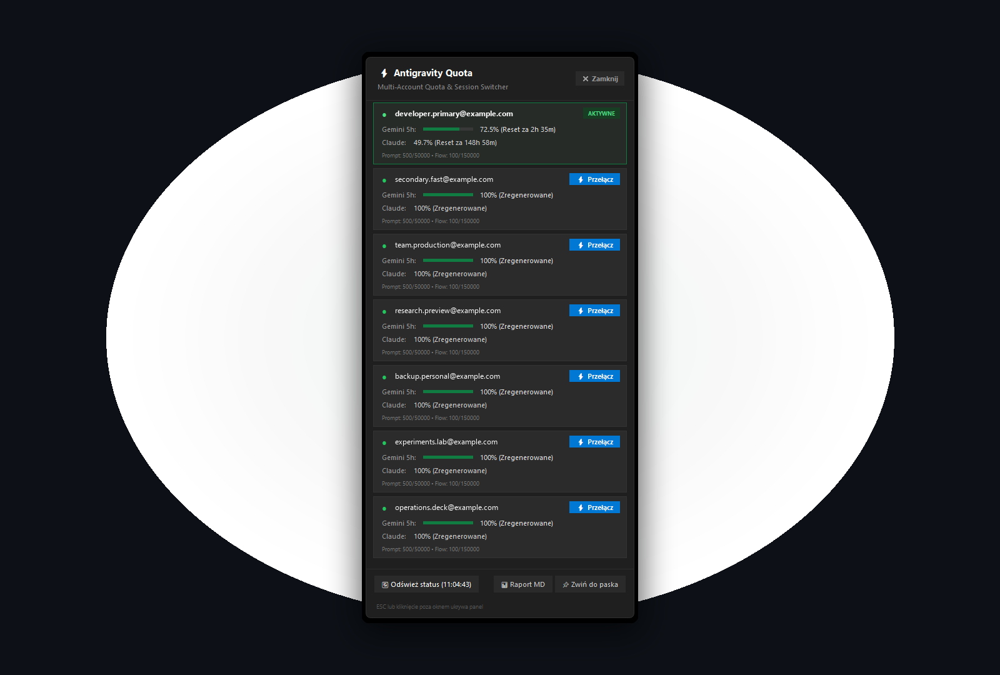

# Antigravity Quota Tray

> 🌐 [English](README.md) · **Polski**

> Aplet zasobnika systemowego (Windows System Tray) oraz narzędzie CLI do monitorowania limitów modeli AI (Gemini i Claude) w środowisku Google Antigravity oraz przełączania aktywnych kont sesji.

<p align="center">
  
</p>

---

## Możliwości

* **Podgląd limitów w czasie rzeczywistym:** Odczytuje aktualne limity z lokalnego serwera językowego Antigravity (obsługa wydań 2.34+ oraz wcześniejszych) lub lokalnego rejestru w trybie offline.
* **Przełączanie kont sesji:** Umożliwia zmianę aktywnego konta w Windows Credential Managerze (`gemini:antigravity`) z poziomu panelu zasobnika lub wiersza poleceń bez konieczności restartu całego edytora.
* **Integracja z powłoką Windows 11:** Panel flyout z obsługą ciemnego motywu, zaokrąglonych rogów i cieni DWM, zamykany po utracie fokusu lub wciśnięciu klawisza Escape.
* **Obsługa wielu monitorów:** Okno otwiera się na monitorze, na którym znajduje się kursor myszy i kliknięta ikona zasobnika.
* **Odporność procesu:** Bezpieczne wznawianie pętli zdarzeń po wybudzeniu systemu ze stanu uśpienia oraz obsługa zamykania nieodpowiadających instancji w tle.

---

## Architektura projektu

```
antigravity-quota-tray/
├── tools/
│   ├── tray_model.py       # Integracja z Win32, DWM, zarządzanie procesem i geometrią okna
│   ├── tray_engine.py      # Komunikacja z Language Serverem, Windows Credential Manager, wyliczanie czasów odnowienia
│   ├── tray_widget.py      # Interfejs Tkinter z kolejką zdarzeń thread-safe i integracją z pystray
│   └── quota_tracker.py    # Interfejs CLI, parsowanie tokenów JWT i operacje na poświadczeniach
├── tests/
│   └── test_spec007_quota_resilience_canary.py # Testy jednostkowe i regresyjne
├── pyproject.toml          # Konfiguracja pakietu Python (PEP 517/621)
└── .github/workflows/
    └── ci.yml              # Weryfikacja testów w środowisku Windows
```

---

## Szybki start

### 1. Instalacja

```bash
git clone https://github.com/robertgdaniec/antigravity-quota-tray.git
cd antigravity-quota-tray
pip install -e .
```

### 2. Uruchomienie apletu zasobnika

```bash
antigravity-quota-tray
```

Lub bezpośrednio przez interpreter:

```bash
python tools/tray_widget.py
```

### 3. Obsługa z wiersza poleceń (CLI)

```bash
# Wyświetlenie aktualnego stanu wszystkich zapisanych kont:
quota-tracker

# Zapisanie bieżącej sesji edytora do lokalnego skarbca:
quota-tracker --save-session

# Przełączenie aktywnego konta:
quota-tracker --switch jan.kowalski@example.com

# Wygenerowanie raportu w formacie Markdown:
quota-tracker --markdown
```

---

## Testy automatyczne i integracja CI

Pakiet testów weryfikuje kluczowe mechanizmy odpornościowe aplikacji:
* **Wielowektorowa detekcja Language Servera:** Odczyt zmiennych środowiskowych procesu potomnego oraz komunikacja przez protokół ConnectRPC.
* **Auto-recovery blokad PID i HWND:** Automatyczne przejmowanie kontroli po nieodpowiadających instancjach bez zawieszania procesu.
* **Geometria na wielu monitorach:** Poprawne pozycjonowanie panelu flyout w obszarze roboczym aktywnego ekranu przy zróżnicowanym skalowaniu High-DPI.
* **Zarządzanie poświadczeniami:** Bezpieczna integracja z Windows Credential Managerem w trybie izolowanym.

Uruchomienie pełnego zestawu testów lokalnie:

```bash
pytest -v
```

Projekt posiada również zautomatyzowany potok CI (`.github/workflows/ci.yml`), który uruchamia testy w środowisku `windows-latest` przy każdym commicie i pull requeście.

---

## Licencja

Oprogramowanie dystrybuowane na warunkach licencji [MIT](LICENSE).
